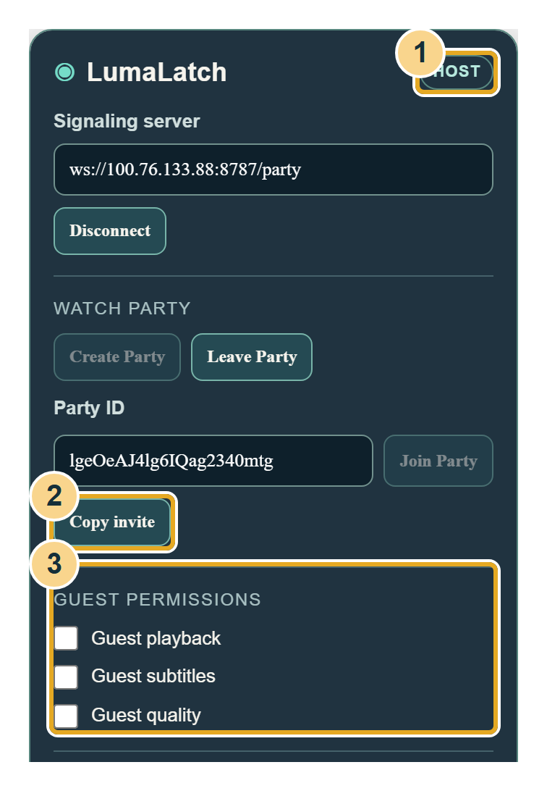

<div align="center">


# LumaLatch

**Watch Jellyfin together over your Tailscale network.**

A Chrome extension for shared playback, paired with a small private signaling server.

[](https://github.com/RainerDylan/LumaLatch/actions/workflows/ci.yml)


[**Download**](https://github.com/RainerDylan/LumaLatch/releases/latest) · [**Illustrated setup guide**](docs/Quick-Start.pdf) · [Report a bug](https://github.com/RainerDylan/LumaLatch/issues/new?template=bug_report.md)

</div>

## Watch together

LumaLatch adds party controls to Jellyfin's web player. One person creates a party and shares an invite. Everyone streams media directly from Jellyfin; LumaLatch relays playback events over your private network.

- Synchronize play, pause, seeking and playback speed.
- Compensate for clock differences and periodically correct playback drift.
- Let the party host grant or revoke guest playback, subtitle and quality controls.
- Keep the server on your own machine, bound to its assigned Tailscale address.
- Run the Windows server from a portable app with Node.js included.

<div align="center">

<br>
<sub>Actual extension controls. The example party in this picture has ended.</sub>
</div>

## Download

Get the ZIPs from [GitHub Releases](https://github.com/RainerDylan/LumaLatch/releases/latest). **GitHub's “Code → Download ZIP” contains source code; it does not include the executable.**

| Computer / role | Package |
| --- | --- |
| Main Windows PC running the signaling server | [Windows x64 ZIP](https://github.com/RainerDylan/LumaLatch/releases/latest/download/LumaLatch-0.2.0-Windows-x64.zip) |
| Windows or Mac laptop watching Jellyfin | [Laptop / Guest ZIP](https://github.com/RainerDylan/LumaLatch/releases/latest/download/LumaLatch-0.2.0-Guest.zip) |
| Optional server on an Apple Silicon Mac | [Mac Apple Silicon ZIP](https://github.com/RainerDylan/LumaLatch/releases/latest/download/LumaLatch-0.2.0-Mac-Apple-Silicon.zip) |
| Optional server on an Intel Mac | [Mac Intel ZIP](https://github.com/RainerDylan/LumaLatch/releases/latest/download/LumaLatch-0.2.0-Mac-Intel.zip) |

The **Guest ZIP can create or join a party**. Its name means it contains the browser component without the server runtime. The computer running the server and the person hosting a party can be different.

Host packages bundle Node.js. Chrome and Tailscale are separate requirements. ZIPs, downloaded runtimes, dependencies and browser caches are excluded from Git; release downloads include SHA-256 checksums and third-party notices.

## Set up your party

The [19-page illustrated PDF](docs/Quick-Start.pdf) covers **Windows first, pages 1–10**, followed by a **complete Mac walkthrough, pages 11–19**. It assumes Tailscale is connected and Jellyfin is already accessible. Every step has pictures; each operating system has its own instructions.

1. **Main PC:** extract the entire Windows server ZIP, open `LumaLatch.exe`, then click **Start server**. Keep the app open and the computer awake.
2. **Each watching laptop:** extract the Guest ZIP to a permanent folder. In Chrome, open `chrome://extensions`, enable **Developer mode**, click **Load unpacked**, then select its `extension` folder.
3. **Each laptop:** open Jellyfin, click Chrome's Extensions button, select LumaLatch and choose **Enable on this Jellyfin site**. Open the same movie or episode.
4. **Party host:** enter the server's displayed signaling address, click **Connect → Create Party → Copy invite**.
5. **Other viewers:** open the invite, select the same media, then **Connect → Join Party**. The host controls playback until guest permissions are enabled.

**Configuration in the supplied guide:** Jellyfin is at `http://100.76.133.88:8096/web/index.html#/home`; signaling is `ws://100.76.133.88:8787/party`. These are private example addresses for the original setup. For your own network, use your Jellyfin address and the signaling host's assigned Tailscale IP. The extension's server field is editable.

The Windows launcher is unsigned. Mac server packages are unsigned, not notarized and have not been executed on macOS in this development environment. Keep OS protections enabled; managed computers may require administrator assistance. The beginner guide uses the Windows main-PC arrangement; Mac server packages include a `Start LumaLatch.command` launcher and runtime for alternate deployments.

## What runs where?

```text
Jellyfin server ─── media streams ─── Chrome on each watching laptop
                                           │
                                  LumaLatch extension
                                           │
                            private WebSocket over Tailscale
                                           │
                              LumaLatch signaling server
```

The signaling server relays room state. It does not proxy video, store Jellyfin credentials, or choose media for viewers. Everyone needs their own Jellyfin access and must open the same media and version.

## Develop locally

Requirements: **Node.js 22+**, npm, Git and Chrome/Chromium. The source server works on Windows, macOS and Linux. Keep Tailscale connected when starting the CLI on its private interface.

```sh
git clone https://github.com/RainerDylan/LumaLatch.git
cd LumaLatch
npm ci
```

Start the server with its assigned Tailscale IP and the supplied extension origin:

<details>
<summary><strong>Windows PowerShell</strong></summary>

```powershell
$env:TAILSCALE_IP = '100.101.102.103'
$env:PORT = '8787'
$env:JELLYFIN_ORIGINS = 'chrome-extension://pjefkalnibmhbeoiacicjjkjppmonjpf'
npm start
```

</details>

<details>
<summary><strong>macOS / Linux</strong></summary>

```sh
TAILSCALE_IP=100.101.102.103 \
PORT=8787 \
JELLYFIN_ORIGINS=chrome-extension://pjefkalnibmhbeoiacicjjkjppmonjpf \
npm start
```

</details>

Replace `100.101.102.103` with the server computer's assigned address. The extension manifest fixes its ID across installations, so users of the supplied extension share the origin above. Browser connections with other origins are rejected.

Load `extension/` through Chrome's Developer mode. In the player, connect to `ws://YOUR_TAILSCALE_IP:8787/party`. A reachable server returns `{"ok":true}` at `http://YOUR_TAILSCALE_IP:8787/health`.

## Run checks

```sh
npm test
npx playwright install chromium
npm run test:integration
```

For a full check, use `npm run verify`. Playwright stores browsers, profiles and test artifacts under `.cache/` inside the checkout. On a minimal Linux machine, use `npx playwright install --with-deps chromium` to install system dependencies too.

The integration test loads the production extension in **two independent headless Chromium processes**, plays real local media and asserts host-to-guest pause delivery within **50 ms**. It also checks playback restoration, seeking, speed, guest permissions, media-element replacement and host departure. The timing threshold measures local test conditions; network latency and browser scheduling affect real sessions.

GitHub Actions runs the same full suite on Windows for pushes and pull requests.

## Build portable releases

On Windows, install Python 3 and ensure the .NET Framework compiler is available, then:

```sh
npm ci
npx playwright install chromium
node scripts/build-release.mjs
node scripts/verify-release.mjs
```

The build verifies official Node.js runtime downloads, compiles the launcher, renders the illustrated PDF and produces four ZIPs plus `dist/SHA256SUMS.txt`. Verification extracts the actual Windows package, exercises its executable and server on the assigned Tailscale interface, then runs the two-browser test against the packaged extension and server. A connected Tailscale interface is required for this release check.

The HTML guide embeds its pictures, so routine builds need no screenshot recapture. To refresh pictures after UI changes, first build and verify the release to create its native launcher capture, then run `node scripts/illustrate-guide.mjs` on the configured development host and rebuild. Capture currently uses `100.76.133.88:8787`; that interface must be assigned and the port free.

## Project layout

| Path | Purpose |
| --- | --- |
| `extension/` | Manifest V3 service worker, player overlay and site permission popup |
| `server/` | WebSocket room protocol, clock estimates and permission enforcement |
| `desktop/` | Windows launcher and Mac server launchers |
| `tests/` | Protocol tests, real-media fixture and browser integration |
| `scripts/` | Portable packaging, guide captures and release validation |
| `docs/` | Illustrated guide and [protocol contract](docs/contract.md) |

## Current limits

- Chrome 116+ on desktop is required. Safari and iPhone/iPad browsers cannot load this extension.
- Chrome requires manual **Developer mode → Load unpacked** installation; there is no Chrome Web Store listing.
- Rooms live in memory. A party host disconnect ends the room; reconnect with a fresh party and invite.
- Autoplay may require each viewer to press Play once. Invites do not select media or sign in for you.
- Subtitle and quality controls use Jellyfin's native menus; support varies by version and media.
- A passing local 50 ms test does not guarantee that timing over a tailnet. Authenticated real-server playback and native macOS execution still need live checks.

## Contribute

Open an issue with your OS, Chrome version, Jellyfin version and reproduction steps. For changes, keep the implementation small, add a meaningful regression check when needed, run `npm run verify`, and open a pull request. Report vulnerabilities through the [private security channel](SECURITY.md).
